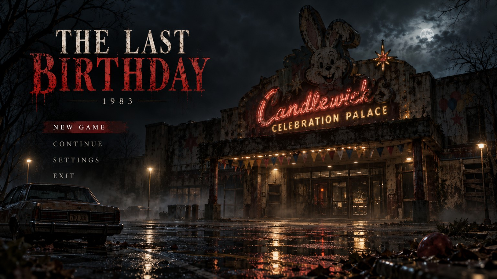

# THE LAST BIRTHDAY — 1983
### A playable first-person WebGL2 survival-horror story • GitHub Pages edition

**Status:** A self-contained **playable vertical slice / Chapter One–Three prototype** with branching endings. This is *not* a finished AAA game or a photorealistic production character build. The concept artwork is used in menus and evidence scenes; explorable environments and the current Mr. Morrow are procedural real-time 3D. Separate skinned, animated prototype `.glb` files are supplied for future art-production work.



## 🚀 Put it on GitHub Pages

1. Extract **every** file, preserving the `assets/`, `src/`, and `tools/` folders.
2. Create a public GitHub repository called `the-last-birthday` (or any name).
3. Upload **index.html**, **style.css**, **src/**, **assets/**, and the README to the repository's default branch (root folder).
4. In the repository, open **Settings → Pages → Build and deployment**. Choose **Deploy from a branch** → **main** → **/(root)** → **Save**.
5. After GitHub Pages finishes building, visit `https://YOUR_USERNAME.github.io/the-last-birthday/`.

There is **no npm, no bundler, no API key, no CDN and no external library**. Modern browsers need **WebGL2 enabled**. For local development, run `python -m http.server 8000` from the game folder and open `http://localhost:8000`. The build may not load from `file://` in browsers that restrict module imports.

### Controls

| Action | Keyboard + mouse | Mobile |
| --- | --- | --- |
| Walk / look | WASD + mouse | Left joystick + drag right side |
| Sprint | Hold Shift | Hold RUN |
| Sneak | Hold C | (desktop only in prototype) |
| Interact / choose | E / click option | E / tap option |
| Toggle flashlight | F | 🔦 button |
| Camera flash (limited) | Q | 📷 button |
| Journal | J | ▤ button |
| Pause | Esc | Ⅱ button |

If the mouse is not captured after closing a note, click the 3D scene again.

## Playable features

- WebGL2 3D palace with **11 zones**: rain-soaked exterior, lobby, grand hall, birthday room, arcade, backstage, security, service passage, boiler room, Edwin's office and the last birthday room.
- Smooth first-person look, WASD movement, sprint/stamina, crouch stealth on desktop, wall/door collision, responsive mobile touch joystick.
- Dynamic flashlight spotlight and draining battery; extra batteries, limited 35mm camera flashes that stun Mr. Morrow.
- Animated articulated **Mr. Morrow** with head tilt, moving ears, hinged-looking jaw, arm/leg motion, stalking, patrol, detection, pursuit, brief camera-flash stun, close encounter and death scene.
- Separate scene-independent **gltf 2.0 rigged GLB prototypes** for Mr. Morrow (1973 and 1983), June Mercer (1973 and 1983), and Edwin Candlewick, with skeleton/skin data and `Idle`, `Walk`, `Reach` animation channels. **These GLBs are supplied for import into DCC tools or future game-engine integration; the current native WebGL2 runtime uses its own procedural Mr. Morrow rig, not the GLBs.**
- Fourteen story-linked doors, locked/unlocked with concrete puzzle conditions.
- Physical pickup positions, evidence journal, archival photo cards, power fuse puzzle, keys, staff pass, water valve and branching dialogue.
- Six final story outcomes plus one encounter / death screen.
- Web Audio ambient hum, room tone, footsteps, door scrape, jingle, heartbeat, camera shutter, stingers and jump-scare audio, synthesized in-browser (no audio downloads).
- In-progress saves via `localStorage`, Continue, pause, audio settings, render scale, sensitivity.

## Honest graphics / model scope

The mood, cinematic UI, and supplied concept images are high-detail. **The browser world itself currently uses a performant stylized procedural mesh renderer** with simplified geometry and physically *inspired* (not physically based / photorealistic) shading. The GLB models are **skinned prototypes**, not final high-resolution actor likenesses or detailed cloth-scanned characters. To reach the visual fidelity of the supplied images, a production team would need high-poly sculpture, retopology, PBR materials, UVs, facial rigs, bespoke mocap/keyframe animations, physically based lighting and scene optimization. See `PRODUCTION_ROADMAP.md`.

## Files

```
index.html               Screens, HUD, journal and choice overlays
style.css                Visual design, responsive layout and horror effects
src/engine.js            Native WebGL2 renderer + custom geometry + lighting/fog
src/world.js             Spatial map, collision walls, decorations, doors and pickups
src/game.js              Story, player, enemy AI, logic, choices, saves and input
src/audio.js             Synthesized Web Audio sound design
assets/menu.png          Original user-provided title-screen image
assets/cover.png         Cinematic June-and-Morrow cover art
assets/other artwork     Original user-provided reference/art assets
assets/models/*.glb      Five skinned prototype character exports
 tools/build_rigged_models.py  Optional model-regeneration helper (requires trimesh + numpy)
GAME_DESIGN_BIBLE.md     Full characters, historical timeline, secrets and endings
PRODUCTION_ROADMAP.md    Specific high-end production milestones
```

## Puzzle progression (spoilers)

1. Read the invitation, open the front door, enter the hall.
2. Find **Robin's birthday photograph** and backstage pass in the **party room**. Picking up the photograph activates Mr. Morrow's movement.
3. Visit the **arcade**: restore the power circuit, pick up the executive office key and optional camera film.
4. Enter **backstage** for Ruth Hale's warning and the fire report.
5. Enter **security** to recover the altered exit log.
6. Open **Edwin's office** to find his signed order and 1973 tape recording.
7. In **maintenance**, open the water valve and collect spare batteries.
8. Recover at least **three** primary documents. Then unseal the door at the **far south of the service passage**.
9. Interact with the birthday cake and choose one of the available endings. Finding at least four primary records plus the tape unlocks the strongest truth-telling option.

The office and backstage also have secondary doorways from the service hall, but they use the same access requirements to prevent bypassing story locks.

## Automated / manual test guide

Run all JS syntax checks with `node --check src/engine.js`, `node --check src/world.js`, `node --check src/audio.js`, and `node --check src/game.js`.

Smoke-test a hosted build in a real browser with **WebGL2**: start New Game; walk to and open main doors; inspect and close several evidence notes; open the journal; test Continue after reloading; find the arcade fuse and ensure security unlocks; verify blocked office/backstage doors without keys; restore power; enter the final room; try another ending; test both desktop and touch controls. Since browser GPU hardware and permissions vary, GPU rendering, device-specific framerate, and touch behavior still require testing on each target device. No software can be truthfully guaranteed error-free on every browser/device.

## Content details / continuity rules

- Present day is **1983**. Candlewick's has been abandoned since **October 27, 1973**.
- June Mercer was **14 in 1973**, and is **24 in 1983**.
- Robin Mercer was **7 when he died during the October 27, 1973 fire**. He cannot appear alive in 1983.
- The fire started at faulty **electrical equipment behind the main stage**. **Edwin Candlewick** ordered the emergency exits chained, trapping guests. **Ruth Hale** warned him about the danger before the catastrophe.
- **Ruth Hale is not physically present in 1983**, only in evidence, testimony, photographs and prior history.
- During the original 1973 operation, Mr. Morrow could perform cheerful prerecorded **birthday greetings and songs**. In **1983 he never speaks, whispers, imitates voices or gives dialogue**. His 1983 audio consists solely of mechanical movement, fabric and footsteps.
- No experiments, child-voice recordings, microphone tests, or research-laboratory backstory.
